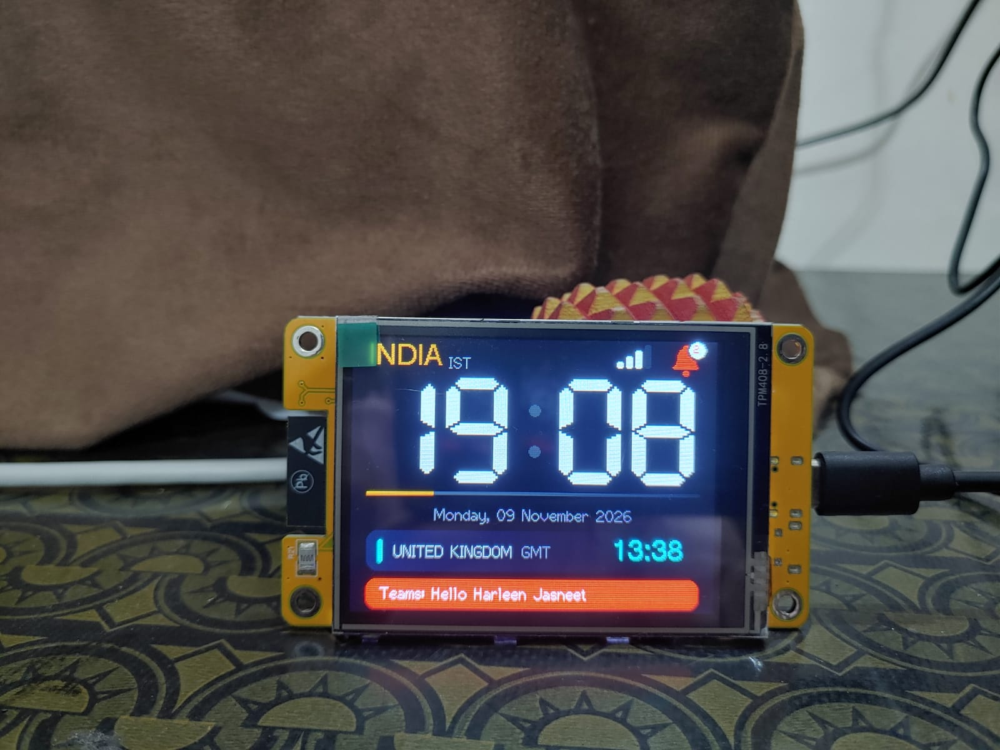

# ESP32 IST + UK Clock: Documentation

A desk clock built on an ESP32 and a 2.8" ST7789 TFT. India (IST) is the big hero time, the UK (GMT/BST) sits underneath, and a bell turns red when any of your systems pushes a notification to a small PHP endpoint.

## Start here

| Page | What's in it |
|------|--------------|
| [Hardware and Wiring](Hardware-and-Wiring.md) | Parts, pin table, power |
| [Setup Guide](Setup-Guide.md) | Step-by-step from zero to a working clock |
| [Notification API](Notification-API.md) | Pushing, clearing and polling notifications, with examples |
| [Troubleshooting](Troubleshooting.md) | Symptom, cause, fix |
| [FAQ](FAQ.md) | Common questions |
| [Roadmap](Roadmap.md) | Ideas and version history |
| [About Me](About-Me.md) | Who built this and why |

## At a glance

- Two time zones from one NTP-synced UTC clock, automatic UK daylight saving
- Notification bell, count badge and bold red message bar
- Several WiFi networks with automatic re-pick when you change floors
- Night dimming, low-memory self-restart, no flash wear: built for 24x7
- Source, license and dev log: see the [README](README.md)
